# Leave Manager – Administrator Guide

*Last updated: 20 October 2026*

**Finding this guide:** on a computer, click **Administrator guide** in the left-hand panel. On a phone or in the Android app, tap **⚙** → **Help** → **Administrator guide**.

This guide is for the **Administrator**: the person who approves leave, keeps the staff list up to date and prints reports. For everyday use by staff, see the [Staff Guide](STAFF-GUIDE.md).

> **About the pictures:** they come from the demo, so they show sample staff. On a phone, the left-hand menu becomes the tabs along the bottom (swipe them sideways to see them all), and **⚙** at the top opens My settings.

**Contents**
1. [Your role](#your-role)
2. [The Dashboard](#the-dashboard)
3. [Approving leave](#approving-leave)
4. [Booking or cancelling leave for someone](#booking-or-cancelling-leave-for-someone)
5. [Cover rules: Sundays, Easter and Christmas](#cover-rules-sundays-easter-and-christmas)
6. [Stand-in approver](#stand-in-approver)
7. [Emails that go out automatically](#emails-that-go-out-automatically)
8. [Employees, Team balances and History](#employees-team-balances-and-history)
9. [Reports and payroll](#reports-and-payroll)
10. [Looking after the Google Sheet](#looking-after-the-google-sheet)
11. [The Android app and Sign in with Google](#the-android-app-and-sign-in-with-google)
12. [Common questions](#common-questions)

## Your role

- Every leave request comes to you by email and on the **Approvals** page.
- You see everyone's leave, notes, balances and history. Staff only see when colleagues are away, not their notes or balances.
- Your own category and role on the Staff tab are both **Administrator**. Administrators don't take leave in Leave Manager, so you have no balances of your own.
- You can always override a cover rule, book leave for anyone, and cancel any leave.

## The Dashboard

The Dashboard opens with four numbers: requests **waiting for approval**, people **away today**, **staff leave still to take** this year across the team, and **cover problems** in the next 8 weeks (orange when there are any).

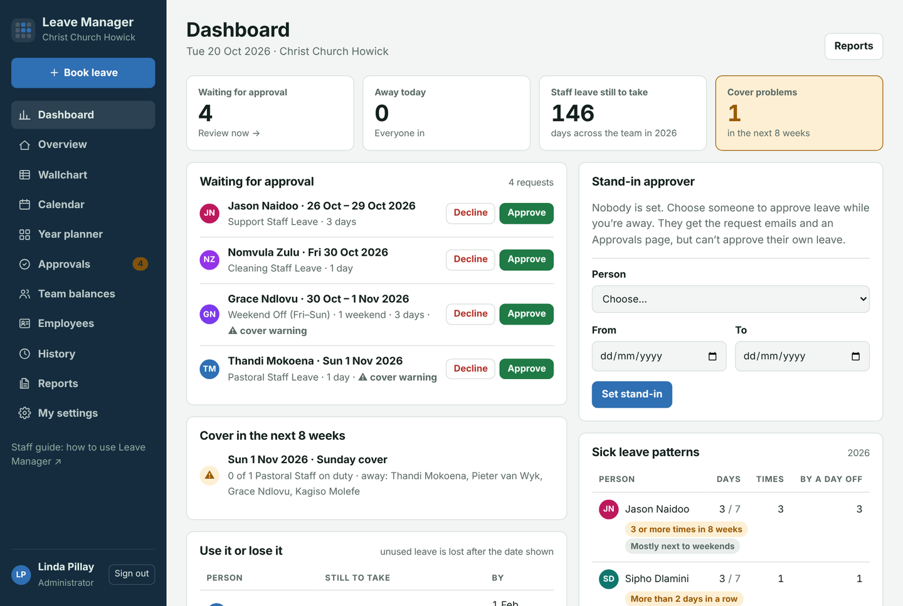

Below them:

- **Waiting for approval**: approve or decline straight from the list. Click a name for the full details first. *⚠ cover warning* means the request breaks a cover rule.
- **Cover in the next 8 weeks**: days when the cover rules aren't met, counting approved and pending leave. Click a day to see who's away.
- **Use it or lose it**: who still has leave to take, and the date it's lost (1 February). The same people get reminder emails (see [Emails](#emails-that-go-out-automatically)).
- **Busiest months**: approved working days off per month, coloured by leave type. Hover over a bar for the numbers.
- **Stand-in approver**: see [Stand-in approver](#stand-in-approver).
- **Sick leave patterns**: sick days and how often, this leave year.

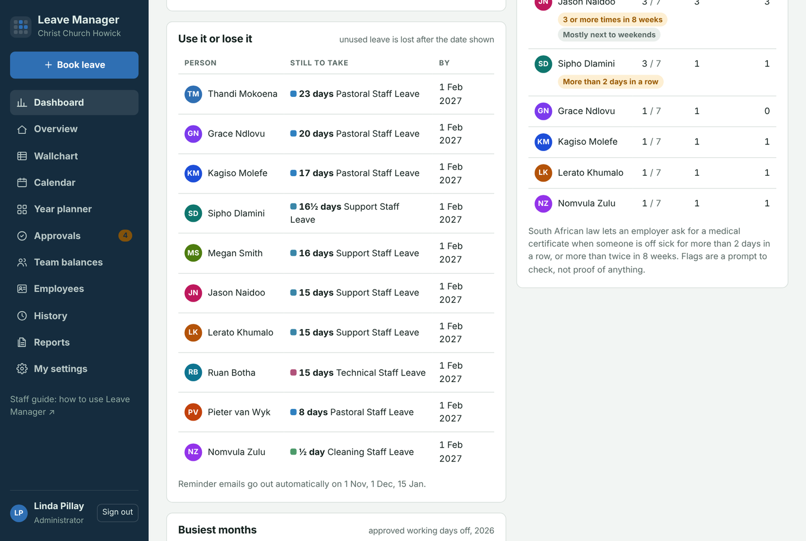

**About the sick-leave flags.** South African law lets an employer ask for a medical certificate when someone is off sick for **more than 2 days in a row**, or **more than twice in 8 weeks**. Leave Manager flags both, plus spells that are **mostly next to weekends or days off**. A flag is a prompt to check, not proof of anything.

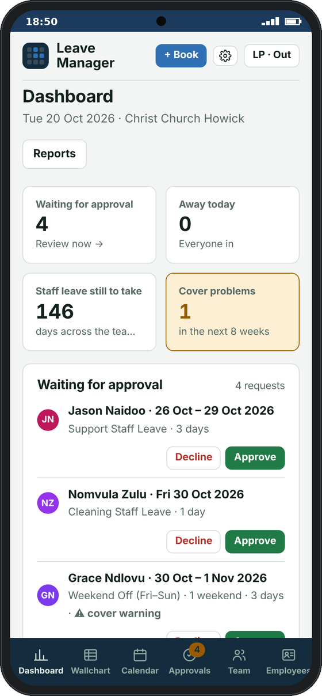 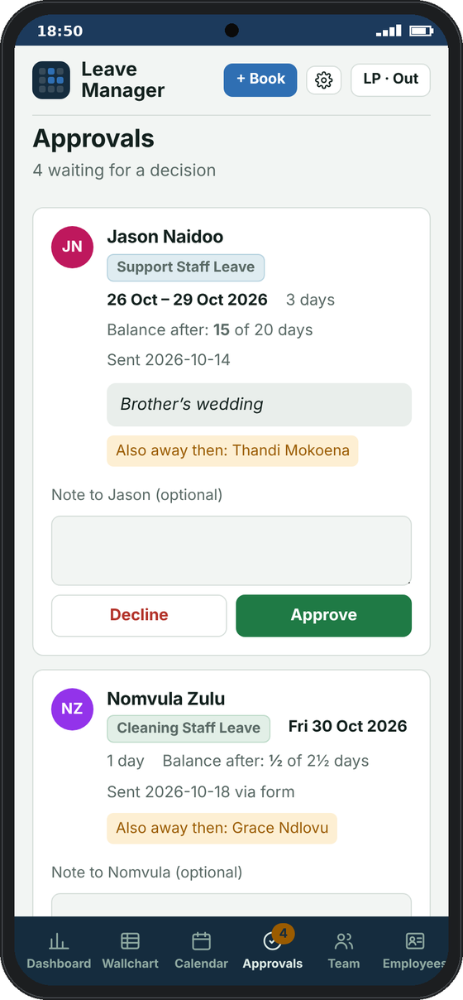

## Approving leave

When someone asks for leave you get an email straight away. You can decide in any of these places:

| Where | How |
| --- | --- |
| **The email** | Click **Review request**, add a note if you like, then **Approve** or **Decline**. No sign-in needed. |
| **Approvals page** | Every waiting request, with the balance after it, who else is away, and any cover warning. |
| **Dashboard** | **Approve** / **Decline** buttons next to each waiting request. |
| **Reports** | A person's report shows a *Waiting for approval* box with the same buttons (they don't print). |
| **Any calendar** | Click a striped (pending) block, then Approve or Decline. |

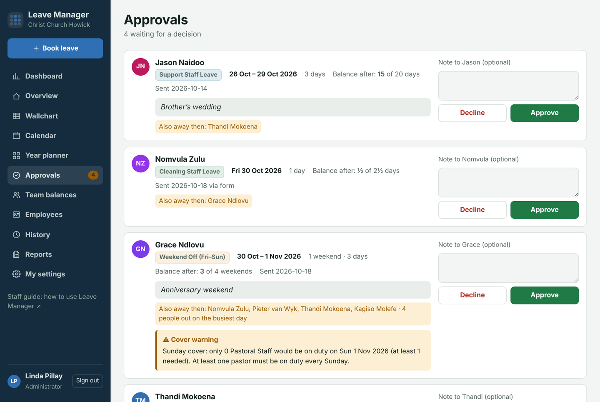

Each card shows who else is away on those days and any **cover warning**:

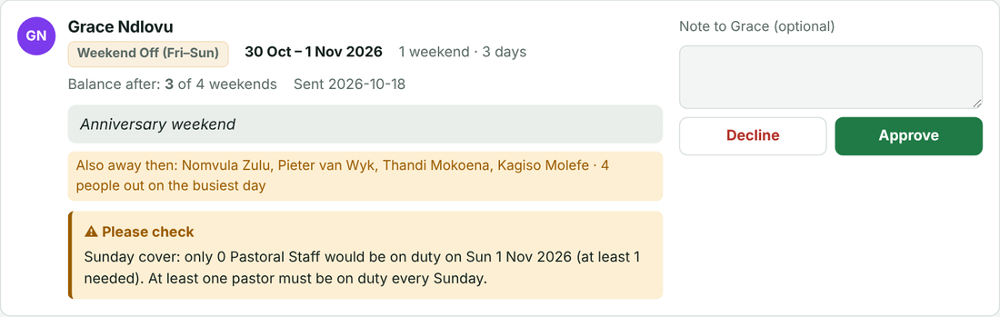

The person gets an email with your decision and note. Approving a request that breaks a cover rule is allowed: you decide.

## Booking or cancelling leave for someone

- **Book:** click **Book leave**, choose the person under **For**, then the leave type and dates. It's approved straight away and the person is emailed. Use this for leave agreed in person, or sick leave someone phones in.
- **Cancel:** open the leave (on any calendar, or Employees) and click **Cancel this leave**. Staff can only cancel their own leave before it starts; you can cancel any leave.
- **Correct a request** (wrong type, dates, half day or note): open it and click **Change**. Your changes keep it approved (or waiting, if it hadn't been decided yet), the person is emailed, and History records what it was before. This works even after the leave has started or ended.
- **When staff correct their own leave:** a request that's still waiting just stays waiting. If it was already **approved**, it comes back to you as **waiting for approval**, and the email says *Changed leave request* and lists what changed. Staff can't change leave that has already started.

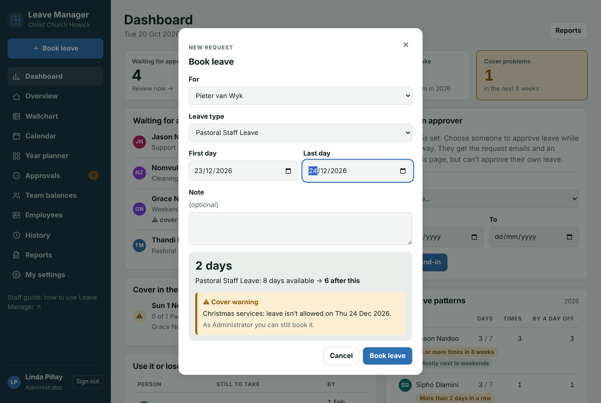

## Cover rules: Sundays, Easter and Christmas

### Blocked days (the easy way)

To stop leave on particular days, such as Christmas, Easter, a church camp or a special service, use **Blocked days** on the **Dashboard**:

1. Click **+ Add blocked days** and give it a name, e.g. *Christmas services*.
2. Choose **When**:
   - **Same dates every year**, e.g. 24 to 26 December.
   - **Around Easter**, e.g. Good Friday to Family Day. Easter moves every year, and Leave Manager works out the dates.
   - **One year only**, e.g. 27 to 29 November 2026.
3. Choose **who** can't take leave: all staff, or only some categories.
4. Choose what happens if someone asks: **Block the request**, or **Allow it, with a warning** to you.
5. Add an optional message for staff, then **Add**.

Each blocked period shows its next dates. Use the switch to turn it off for a year without deleting it, and **Edit** to change or delete it. Staff see blocked days on the calendars (⛔ *No leave*), and a blocked request is stopped with a clear message. You can still book leave on those days yourself. Blocked days are saved as **No leave** rows on the Cover Rules tab, so the app and the sheet always match.

### All cover rules (on the sheet)

Cover rules stop the church being left without the people it needs. They live on the **Cover Rules** tab of the Google Sheet (added automatically).

| Column | What to put |
| --- | --- |
| **Rule** | A short name shown in warnings, e.g. *Sunday cover*. |
| **Type** | **Minimum on duty**: at least this many people must be working. **No leave**: no leave on these days. |
| **Category** | Who it's about. Pick one from the dropdown, or tick several: click the rule's row, then **Leave Manager → Choose categories for a cover rule…**. Blank = all staff. |
| **Days** | Days of the week, e.g. *Sun*. Blank = every day. |
| **From / To** | Easiest: click the rule's row, then **Leave Manager → Choose dates for a cover rule…** and use the date pickers: all year, the same dates every year, around Easter, or one year only. You can also type them: blank = all year, *2026-12-24* (one year), *24 Dec* (every year), *Easter-2* (Good Friday), *Easter+1* (Family Day). |
| **Minimum** | For *Minimum on duty*: how many must be working (default 1). |
| **Action** | **Warn**: staff can still send the request; you see a warning. **Block**: staff can't send it. |
| **Message** | Optional extra text for the warning. |
| **Active** | Untick to switch a rule off. |

The tab starts with three examples:
- *Sunday cover*: at least 1 Pastoral Staff on duty every Sunday (Warn, on).
- *Easter services*: Good Friday to Family Day (off).
- *Christmas services*: 24 to 26 December (off).

Tick **Active** on the ones you want, and change **Warn** to **Block** where a rule must never be broken.

Warnings show up:
- for **staff**, in the request form as they choose dates;
- for **you**, on the Approvals page, the Dashboard and the request email (subject starting **⚠**);
- in the **weekly email** for any uncovered day.

You can always override a warning or a block.

## Stand-in approver

Going on leave yourself? Choose someone to approve leave while you're away.

1. On the **Dashboard**, find **Stand-in approver**.
2. Choose the **Person**, the **From** and **To** dates, then **Set stand-in**.

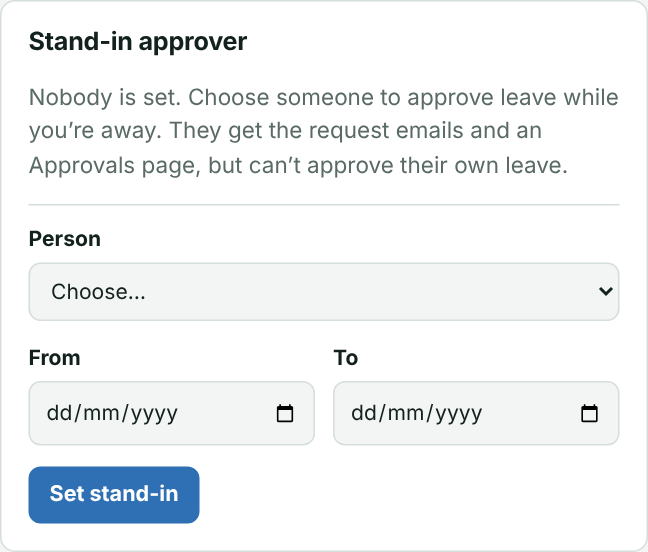

During those dates the stand-in:
- gets an email when they're chosen, and every new request by email;
- sees an **Approvals** page in Leave Manager and can approve or decline other people's leave, but not their own.

They don't see the Dashboard, Reports for others or History. You keep full access throughout. After the **To** date their access stops by itself. **Remove** ends it early. Every change is recorded in History.

## Emails that go out automatically

| Email | Who gets it | When |
| --- | --- | --- |
| New request (with ⚠ cover warning if any) | You, and the stand-in while active | Straight away |
| Approved / declined | The person | When you decide |
| Leave cancelled | You | When someone cancels approved leave |
| **Who's away this week** | All staff | Every Monday about 6am |
| **Use it or lose it** reminder | Each person with unused leave | 1 Nov, 1 Dec and 15 Jan, about 6am |
| Reminder summary | You | Same days as the reminders |
| You're the stand-in | The stand-in | When you choose them |

**To switch them on or off:** in the app, go to **My settings → Automatic emails** (on a phone, tap **⚙** at the top). Untick **“Who's away this week” email** to stop the Monday email, or choose a different day. Untick **“Use it or lose it” reminders** to stop the reminders. Changes take effect straight away and are recorded in History.

You can also change them on the **Settings** tab of the sheet:
- **WeeklyEmail**: the day of the week, or blank to switch it off.
- **ReminderDates**: e.g. *1 Nov, 1 Dec, 15 Jan*, or blank to switch them off.

To see what staff will receive, use the sheet menu **Leave Manager → Preview the weekly “who's away” email** or **Preview the “use it or lose it” emails**. Previews go only to you.

## Employees, Team balances and History

- **Employees:** the list shows each person's main staff leave this year as **days used** and **days left of their allowance** (e.g. *11 used · 13 left of 24*), with a bar showing how much is used. Pick a person to see every date they've had off, filtered by leave type and status. Click a date to open the request.
- **Team balances:** everyone's balances in one table.
- **History:** every request, decision, cancellation and stand-in change, newest first. Filter by period, person and action, or search.

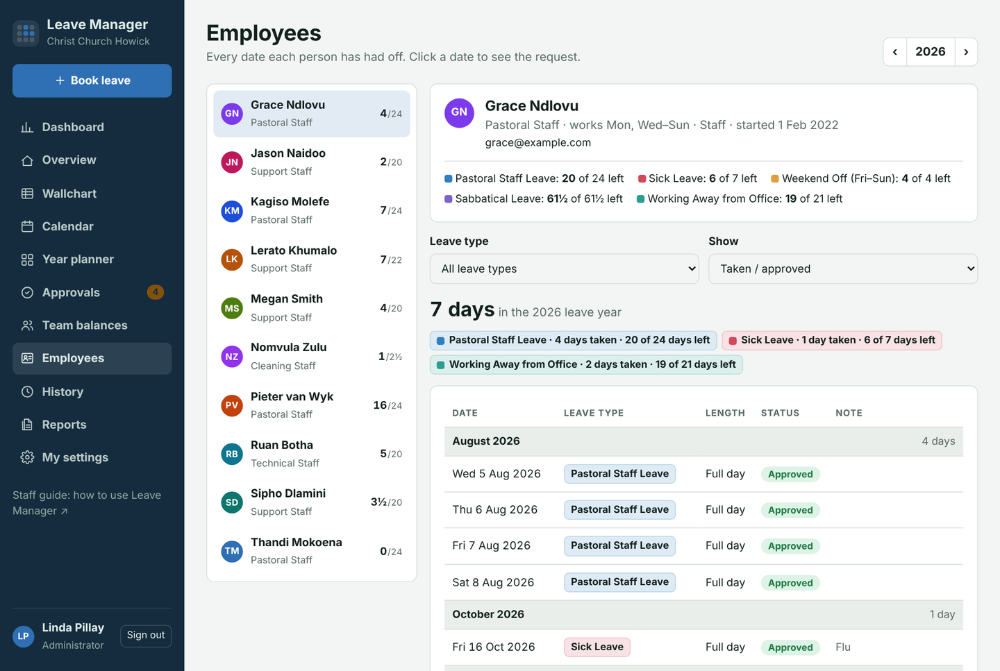

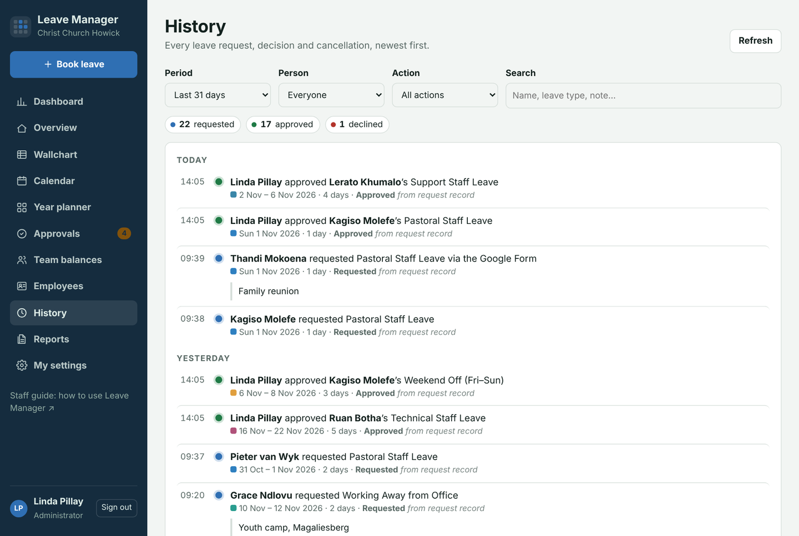

## Reports and payroll

**Reports** has:
- **One employee**: a professional leave report with signature lines. Requests still waiting for approval appear in a highlighted box at the top, with Approve/Decline buttons on screen.
- **All staff — summary**: one landscape page with everyone's figures.
- **All staff — full detail**: the summary plus every person's report.
- **Payroll — unpaid leave**: working days of unpaid leave per person per month, plus a list of each unpaid leave booking. **Download CSV** gives a spreadsheet file for whoever does salaries (on the Android app it opens the share menu, e.g. email or Drive).

Use **‹ 2026 ›** to choose the year and **Print / Save as PDF** to print.

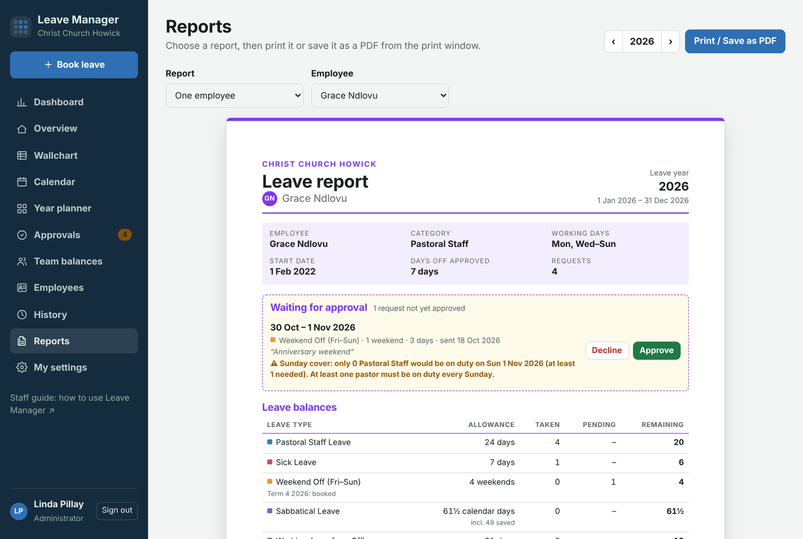

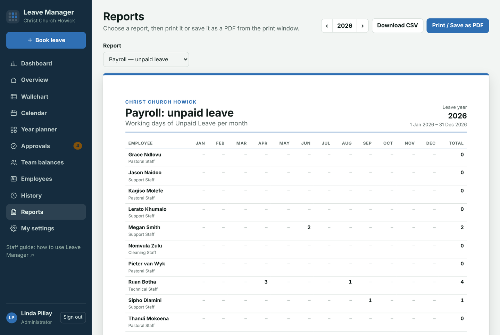

## Looking after the Google Sheet

### Setup: change everything without the spreadsheet

In Leave Manager, click **Setup** in the left-hand panel (on a phone: **⚙ → Open Setup**). Every change is saved to the Google Sheet straight away, so you don't need to know what the columns mean.

| Section | What you can do |
| --- | --- |
| **Church** | Church name, days the church is open, when the leave year starts, part-year allowances, school-holiday weekends, automatic holiday updates, a copy-to email, the web address and an optional Google Calendar. |
| **Staff** | Add someone (they get a temporary PIN, shown with a message to send them), change their category, role, start date, colour or working days (tick the days), give a new PIN, or mark them as having left. |
| **Categories** | Each category's usual working days, and how many days of each leave type it gets per year. Leave a box empty if that category doesn't get that leave. |
| **Leave types** | Switch a type **off** if you don't use it (e.g. **Sick Leave**): it disappears from requests, balances, calendars, reports and the Google Form, and existing records are kept. Edit how each type works, or add a new one (e.g. Family Responsibility Leave). |
| **Cover rules** | “People on duty” rules (e.g. at least one pastor every Sunday) and blocked days. |
| **Holidays & terms** | Add a local holiday, or correct school term dates. (Both fill in automatically.) |
| **Extra days** | Give one person extra days in one year (e.g. +2 for long service), or take days away (e.g. −5 already taken before Leave Manager). |

**Safety checks:** there's always at least one Administrator, two people can't share an email address, and a category can only be deleted when nobody is in it.

The control panel in the Google Sheet has an **Open Setup** button too.

### The control panel

In the Google Sheet, choose **Leave Manager → Open control panel**. A panel opens on the right with everything in one place:

- **At a glance:** staff, requests waiting for approval, who's away today, cover rules switched on, the stand-in approver, the automatic emails, and when holidays and terms were last updated.
- **Links:** Leave Manager, the Google Form, both guides, and the Staff tab.
- **Staff:**
  - **Add staff member:** type their name and email, and choose their category and start date. Leave Manager gives them the next ID, a colour and a **temporary PIN**, adds them to the Google Form, and shows a ready-made message to send them.
  - **New PIN:** gives someone a new temporary PIN if they've forgotten theirs. They choose their own when they next sign in.
  - **Mark as left / Back on staff:** they can no longer sign in, but their history is kept.
  - Each person shows **Own PIN** or **Temporary PIN**, so you can see who still has to choose theirs.
- **Cover rules & blocked days**, **Holidays & school terms** (update now), **Emails** (previews to you only) and **Maintenance** (refresh the form lists, secure PINs, colour codes, set up or repair).

The Leave Manager menu itself now only has the items that need you to click a row first (choosing categories or dates for a cover rule) and **Set up or repair the workbook**. Reload the sheet once to see the new menu.

Open it from **Open the Google Sheet** in the app's left-hand panel.

| Tab | What you do there |
| --- | --- |
| **Staff** | One row per person: ID, name, email, category, working days (blank = the category's), role, start date, PIN, colour, active. |
| **Categories** | Each category's working days and how many days of each leave type it gets. |
| **Leave Types** | Leave types, colours and rules. |
| **Cover Rules** | See [Cover rules](#cover-rules-sundays-easter-and-christmas). |
| **Adjustments** | Extra or fewer days for one person in one year, e.g. *S05, 2026, SSL, 2, Long service*. Use negative days to subtract. |
| **Public Holidays / School Terms** | Filled in automatically every month. |
| **Requests / History** | Written by the app. Don't edit them by hand. |
| **Settings** | Church name, open days, email timing, and other settings. Each row says what it does. |

**New staff member:**
1. Add a row on Staff with the next ID (e.g. S12), their name, email (their Google account if they'll use Sign in with Google), category, role *Staff*, start date and a 4-digit PIN.
2. Tick **Active**.
3. Run **Leave Manager → Refresh form lists** so they appear on the Google Form.
4. Send them the web address, the Android app link and the [Staff Guide](STAFF-GUIDE.md).

Their leave is pro-rated automatically if they start part-way through the year.

**PINs:** the PIN you type on the Staff tab is a temporary one. The first time someone signs in with it, they must choose their own PIN. All PINs are stored scrambled, so nobody can read them, including you:
- *h:…* in the PIN column means a PIN you gave out (they'll be asked to choose their own).
- *u:…* means they've chosen their own.

The **Employees** page also shows whether each person has chosen their own PIN yet.

**Forgotten PIN:** type a new temporary PIN (e.g. 4821) over the old one on the Staff tab and tell them. They sign in with it and choose a new one. People who use **Sign in with Google** don't need a PIN.

**Changing someone's category:** pick the new category from the drop-down in their **Category** cell on the Staff tab, then reload Leave Manager. Their working days and allowances change straight away. Capitals, extra spaces and the style of dash don't matter, but the name must otherwise match a row on the **Categories** tab. If it doesn't, the Dashboard and Employees page show a **⚠ Check the Staff tab** warning naming the person.

**Renaming a category:** change the name on the **Categories** tab. Everyone in that category on the Staff tab is updated to the new name automatically. Also update the name in any **Cover Rules** that mention it.

**Someone leaves:** untick **Active**. Their history is kept, but they can't sign in and don't appear on calendars.

**Colours:** type a hex code (e.g. *#2F6FB3*) in the Colour column, or staff choose their own under My settings.

## The Android app and Sign in with Google

- **Android app link for staff:** <https://github.com/pian1966/leave-manager/releases/latest/download/LeaveManager.apk>. The app shows the live site, so updates appear without reinstalling. Occasionally a new app version adds phone features. The app checks for this itself and shows an **Update available** banner; installing over the old version keeps everyone signed in.
- **iPhone:** Safari → Share → *Add to Home Screen*.
- **Sign in with Google** works for anyone whose email on the Staff tab is a Google account. Everyone can still use email and PIN.

## Common questions

| Question | Answer |
| --- | --- |
| Someone booked the wrong leave type | Cancel it and book the right type for them. |
| A cover warning seems wrong | Check the rule's Category and Days on Cover Rules, and the staff member's category on Staff. |
| The weekly email didn't arrive | Check it's switched on under **My settings → Automatic emails**, and use the Preview menu item to test. Emails go to staff with real email addresses only. |
| A stand-in can't see Approvals | Check today is between the From and To dates on the Dashboard. |
| Balances look wrong | Check the person's category, start date and any Adjustments rows. |
| Staff can't sign in | Check their email on Staff and that **Active** is ticked. Reset the PIN if needed. |
