# Leave Manager – Staff Guide

*Last updated: 20 October 2026*

The Leave Manager is where you request leave, see how many days you have left, and check who else is away. It works on a computer, tablet or phone.

> **About the pictures:** each section shows the computer view first, then the Android app. The people in the pictures are sample staff. The phone app works the same way as the computer version: the left-hand menu becomes the tabs along the bottom, and **⚙** at the top opens My settings.

## Welcome

**Web address:** <https://pian1966.github.io/leave-manager/> — bookmark it.

**Finding this guide again:** on a computer, click **Staff guide** in the left-hand panel. On a phone or in the Android app, tap **⚙** (top right) → **Help** → **Staff guide**.

You need two things to sign in:

- **Your work email** — the one the church has on record for you.
- **Your PIN** — a number the Administrator gives you. It is not your email password.

All leave requests go to the Administrator, who approves or declines them. You get an email either way.

## Signing in

1. Open the web address above.
2. Type your **work email** and your **PIN**.
3. Click **Sign in**. You stay signed in for about 6 hours.

**The first time you sign in with your PIN,** you're asked to choose your own PIN (4 to 8 digits). Type it twice and tap **Save my PIN**, then use it from then on. Don't use your bank card PIN, or easy ones like 1234 or 1111. Your PIN is stored scrambled, so nobody can read it, not even the Administrator. To change it later, go to **My settings → Change my PIN**.

**Sign in with Google:** if your email on the staff list is a Google account (Gmail or a Google Workspace address), you can tap **Sign in with Google** instead and skip the PIN. In the Android app, choose your account from the list that pops up. If it says your account isn't on the staff list, ask the Administrator to check your email address in the Staff sheet.

**To sign out:** click **Sign out** at the bottom of the left panel (on a phone, the **Out** button at the top right), then confirm.

**Forgotten your PIN, or it doesn't work?** Ask the Administrator. They can give you a new one straight away, and you'll be asked to choose your own again when you sign in.

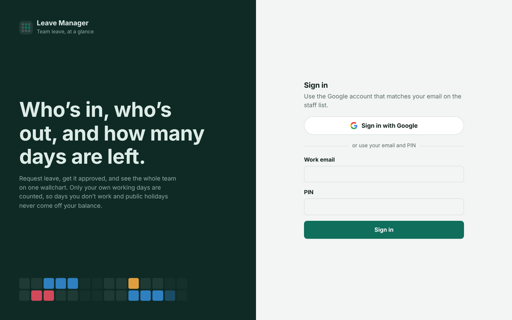

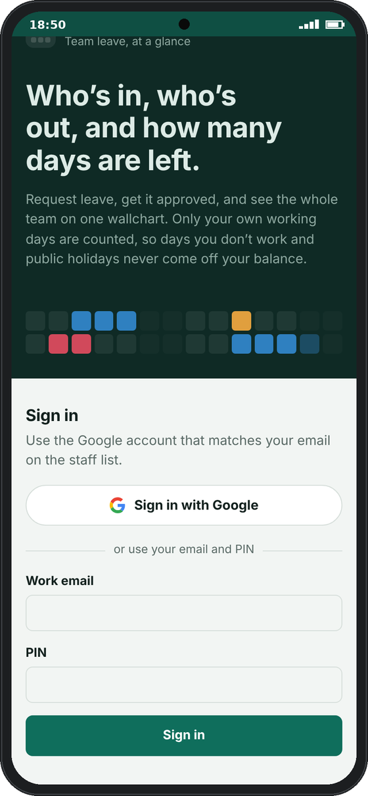

**On your phone:** open the web address in your browser, then use *Add to Home Screen* (iPhone: Share button; Android: the ⋮ menu). It then opens like an app.

## Your Overview page

The Overview opens first and shows your own leave at a glance.

- **Balance cards** — one per leave type you get, e.g. “13 of 24 days left”. The bar shows days taken (solid) and days waiting for approval (striped).
- **Weekend Off card** (Pastoral Staff) — also shows whether this school term's weekend is still free or already booked.
- **Last year's days** — in January a highlighted line shows any days left over from last year, e.g. “+ 5 left from 2026 · use by 1 Feb”.
- **Who's away** — colleagues off on the next 7 days the church is open. A striped name means that leave is still waiting for approval.
- **My leave** — your upcoming and recent requests with their status. Click one to see the details.
- **Public holidays** — the next few holidays.

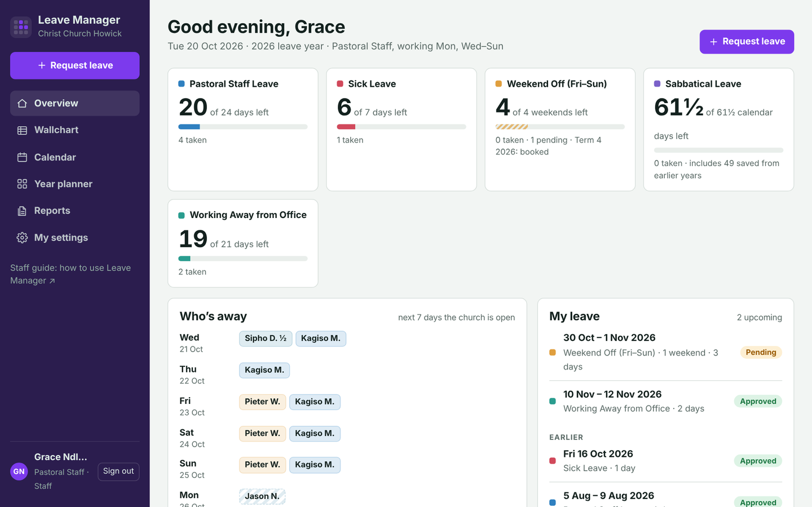

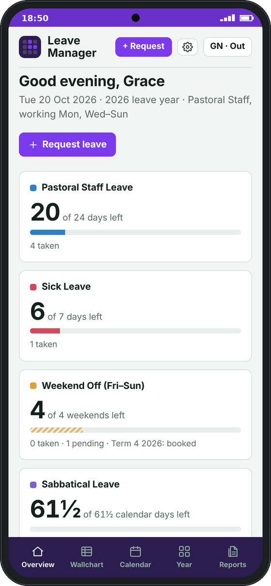

## Requesting leave

1. Click **Request leave** (top of the left panel, or **+ Request** on a phone). You can also click an empty day on your own row of the **Wallchart**.
2. Choose the **Leave type**. You only see the types your staff category gets.
3. Pick the **First day** and **Last day**. The Last day fills in with the same date, so for one day you're done; for longer, change the Last day.
4. For a single day you can choose **Morning** or **Afternoon** for a half day (not for every leave type).
5. Add a **note** for the Administrator saying what the leave is for (e.g. *family visit*, *doctor's appointment*). The note is required; the request can't be sent without it.
6. Check the grey box: it shows how many days this uses and what you'll have left. If anything is wrong, a red box lists **every** problem (for example overlapping leave *and* not enough days), and the **Send request** button stays grey until they're all fixed.
7. Click **Send request**.

**Cover warnings:** if your dates leave too few people on duty (for example no pastor on a Sunday) or fall in a no-leave period such as Easter or Christmas, an orange **Cover warning** appears. You can usually still send the request; the Administrator sees the warning and decides. If the request is blocked, a red message says so; speak to the Administrator.

**Cover warnings:** if your dates leave too few people on duty (for example no pastor on a Sunday) or fall in a no-leave period such as Easter or Christmas, an orange **Cover warning** appears. You can usually still send the request; the Administrator sees the warning and decides. If the request is blocked, a red message says so; speak to the Administrator.

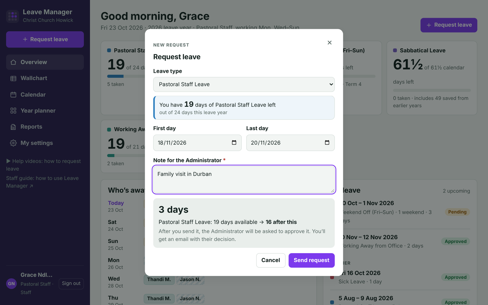

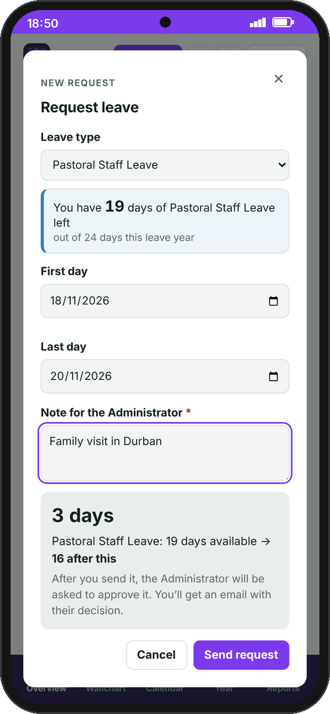

**What counts as a day off:** only *your own* working days. Days you don't normally work, days the church is closed (Tuesdays) and public holidays are never taken off your balance. One exception: when a public holiday falls on a Sunday, the Monday becomes the holiday, so if you work Sundays that Sunday is a normal working day and leave on it does use a day (you get the Monday off instead). Sabbatical is the exception: it counts every calendar day.

**Prefer a form?** Use **Request via Google Forms** in the left panel. Fill it in with the same email you sign in with. The note is required there too. If the request can't be booked (for example, not enough days left), you'll get an email explaining why.

## Your leave allowances

What you get depends on your staff category. The leave year runs 1 January to 31 December.

| Leave type | Pastoral Staff | Support Staff | Part-Time Technical Staff | Cleaning Staff | How it's counted |
| --- | --- | --- | --- | --- | --- |
| Pastoral Staff Leave | 24 days | – | – | – | Working days |
| Support Staff Leave | – | 20 days | – | – | Working days |
| Technical Staff Leave | – | – | 20 days | – | Working days |
| Cleaning Staff Leave | – | – | – | 3 days | Working days |
| Sick Leave | 7 days | 7 days | 7 days | 7 days | Working days |
| Weekend Off (Fri–Sun) | 4 weekends | – | – | – | 1 per school term |
| Sabbatical Leave | 12.5 days a year | – | – | – | Calendar days, builds up |
| Working Away from Office | 21 days | – | – | – | Working days |
| Unpaid Leave | Any | Any | Any | Any | Doesn't use an allowance |

Usual working days: Pastoral Staff Mon and Wed–Sun; Support Staff Mon and Wed–Fri; Part-Time Technical Staff Mon, Wed–Fri and Sun; Cleaning Staff Fridays. Yours may differ; the Overview shows your own.

**No carry-over — use it by 1 February.** Unused Pastoral, Support, Technical and Cleaning Staff Leave can still be taken up to and including 1 February of the next year. After that it's lost. Leave you take in January uses last year's days first. Sick Leave, Weekend Off and Working Away start fresh each 1 January.

**Weekend Off** is always a whole weekend, Friday to Sunday, one per school term. When you choose Weekend Off, just pick any day of the weekend you want: Leave Manager sets the Friday and Sunday for you. A weekend in the school holidays counts towards the term that has just ended.

**Sabbatical** builds up by 12.5 calendar days each year from your start date, to a maximum of 87.5 days (about 3 months after 7 years).

**Starting part-way through the year?** Your Pastoral, Support, Technical or Cleaning Staff Leave is reduced in proportion for that first year.

## After you send a request

The Administrator gets an email straight away and approves or declines it. You get an email with the decision and any note they add.

| Status | What it means |
| --- | --- |
| Pending | Waiting for the Administrator. The days are held for you and show striped on the calendars. |
| Approved | Your leave is booked. |
| Declined | Not approved. The days go back to your balance. Read the Administrator's note in the email or by clicking the request. |
| Cancelled | The request was withdrawn. The days go back to your balance. |

**To cancel:** click the request (under **My leave**, or on any calendar), then **Cancel this leave** and confirm. You can cancel a pending request at any time, and approved leave until the day it starts. Once leave has started, ask the Administrator.

**To correct a request** (wrong leave type, wrong dates, half day or note): open it and tap **Change**, fix what's wrong, then **Save changes**.
- While it's still waiting for approval, it simply stays waiting with the corrections.
- If it was already approved, it goes back to the Administrator to **approve again** (you'll see a note saying so before you save).
- Once the leave has started, ask the Administrator to correct it.

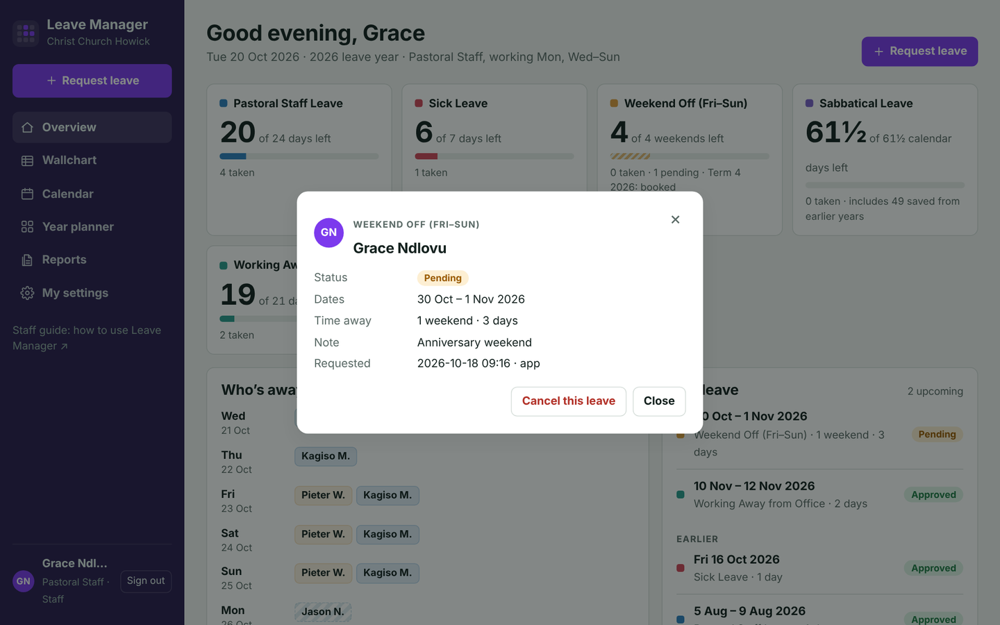

<em>Click any request to see its status and details. Cancel this leave is at the bottom.</em>

## Seeing who's away

Use the left panel (on a phone, the tabs along the bottom).

- **Wallchart** — the whole team on one month grid, one row per person. Coloured blocks are leave; the colour shows the type. Click a block for the details, or an empty day on your own row to book it. Use **‹ Today ›** to change month.
- **Calendar** — a month view with names on each day. Click a day to see everyone who's off.
- **Year planner** — your whole leave year on one page, with your balances and requests beside it.

**How to read the colours:**

- **Solid block** — approved leave.
- **Striped block** — waiting for approval.
- **Half block** — a morning or afternoon off.
- **Shaded day** — a day that person doesn't work.
- **Hatched “Closed” column** — the church is closed (Tuesdays).
- **Yellow day / outlined date** — a public holiday.
- **⛔ No leave** — the Administrator has blocked these days (e.g. Christmas services or a church camp). Leave can't be requested then, or only with a warning.

Hold your mouse over any leave-type label to see its full name and how it works. Click the leave-type buttons above a calendar to hide or show that type, or **Pending requests** to hide leave that isn't approved yet. You see when colleagues are away, but not their notes or balances.

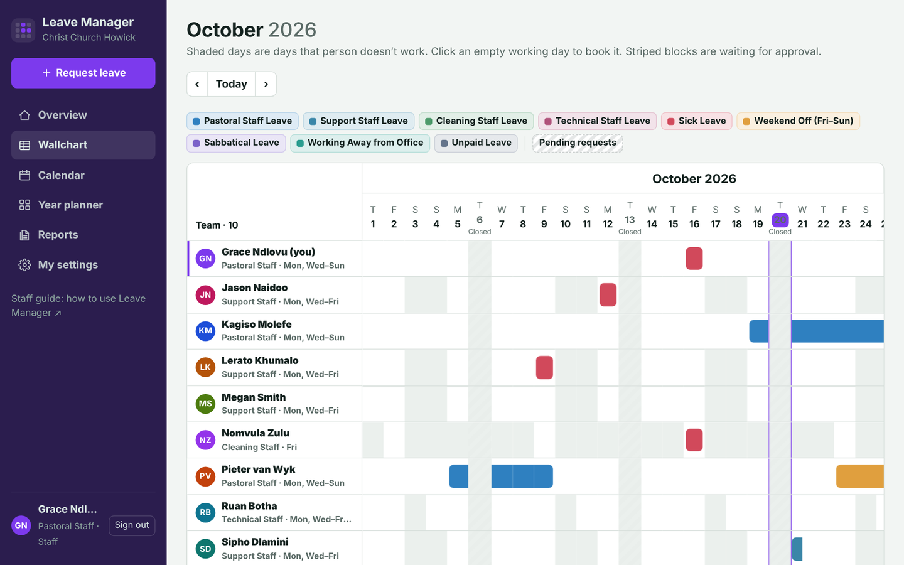

<em>The Wallchart. Your own row is marked “(you)”.</em>

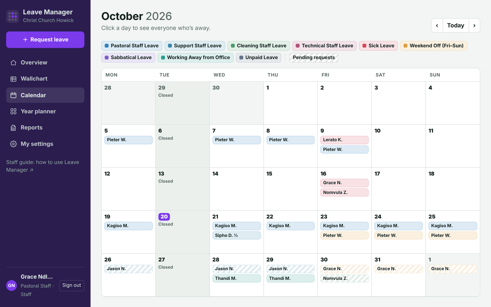

<em>The Calendar. Click a day to see everyone who is off.</em>

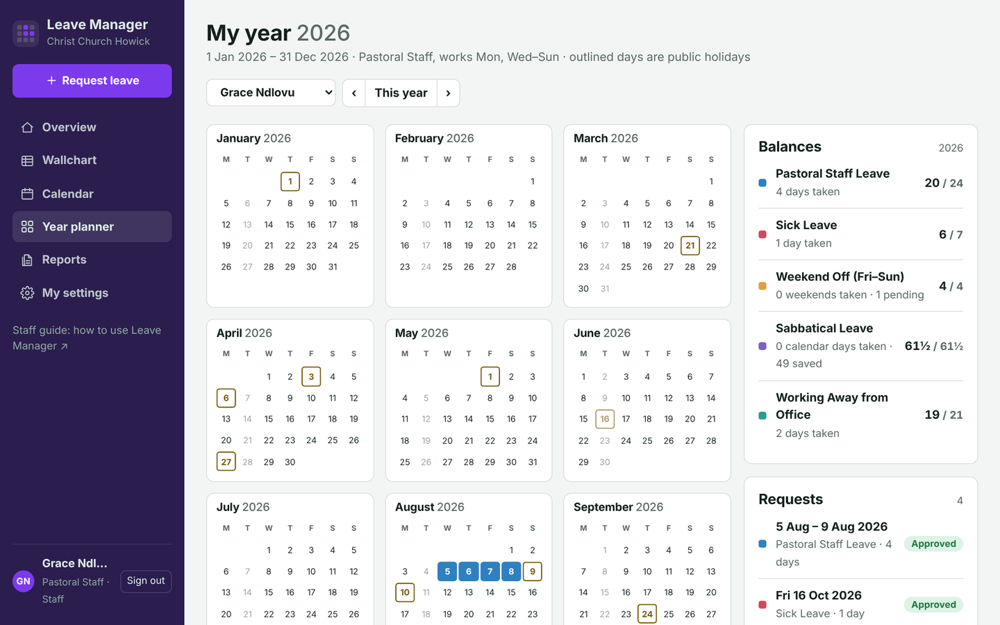

<em>The Year planner.</em>

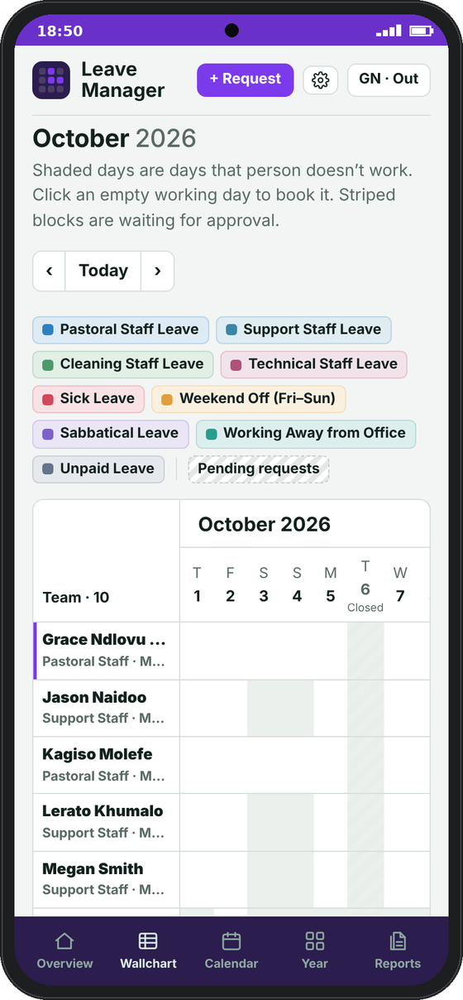 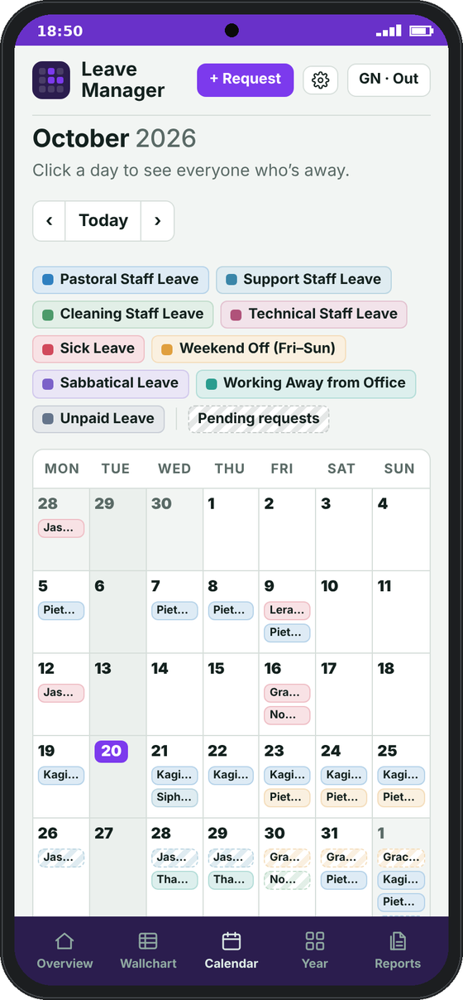

## Printing a leave report

You can print a professional report of your leave, or save it as a PDF.

1. Click **Reports** in the left panel (on a phone, the Reports tab).
2. Use **‹ 2026 ›** at the top to choose the leave year.
3. Click **Print / Save as PDF**. In the print window, choose your printer, or choose **Save as PDF** as the destination.

Leave you've requested that isn't approved yet appears in a highlighted **Waiting for approval** box at the top of the report. Leave you've requested that isn't approved yet appears in a highlighted **Waiting for approval** box at the top of the report. The report shows your details, a table of each leave type (allowance, taken, pending, remaining), every request with its status and who approved it, and lines for your and the Administrator's signatures.

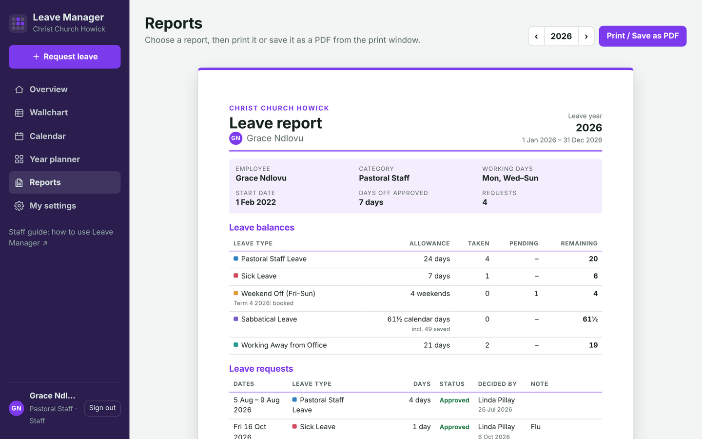

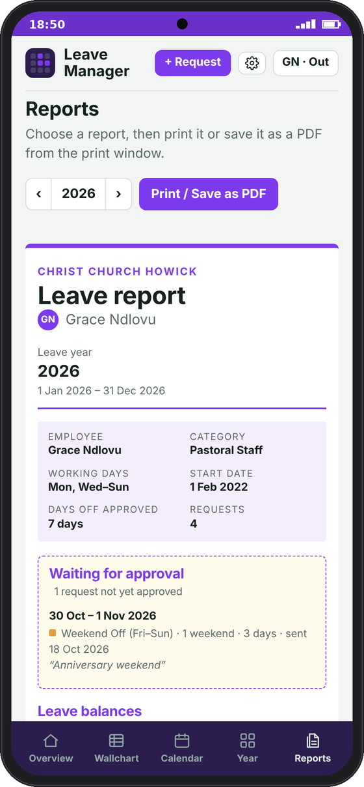

In the Android app, **Print / Save as PDF** opens the phone's print screen. Choose a printer, or **Save as PDF**.

## My settings

Click **My settings** at the bottom of the left-hand menu (on a phone, tap the ⚙ gear at the top).

- **My colour.** Choose one of the colours, or click the colour box to pick any colour. The page shows a preview straight away. Click **Save my colour** to keep it. Your buttons and the sidebar change to your colour, and other people see it on your name badge. It's saved in the Staff sheet, so it follows you to every device.
- **Appearance.** Choose *Match my device*, *Light* or *Dark*.
- **Start page.** Choose the page that opens when you sign in, for example the Wallchart.
- **Help.** Opens this Staff guide (and, for the Administrator, the Administrator guide) in your browser. This is the easiest way to find the guide on a phone or in the Android app.

Appearance and Start page are remembered on the device you set them on, so you can choose differently on your phone and your computer.

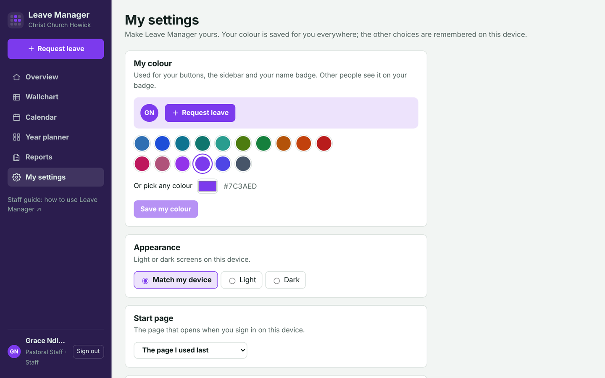

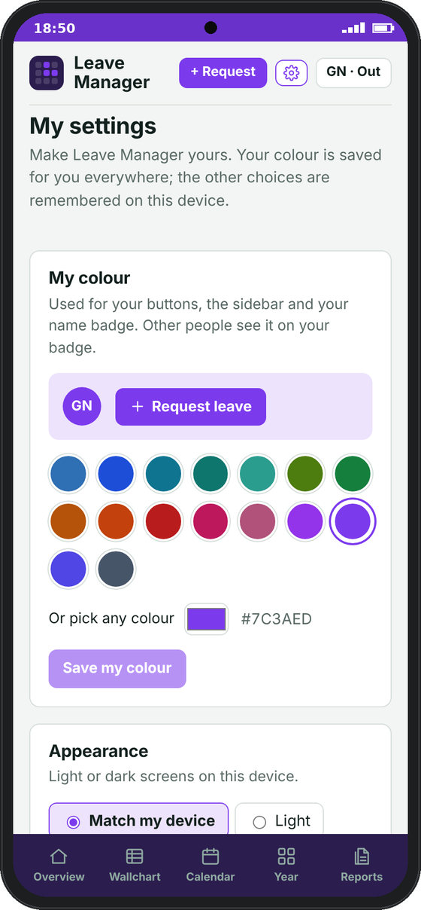 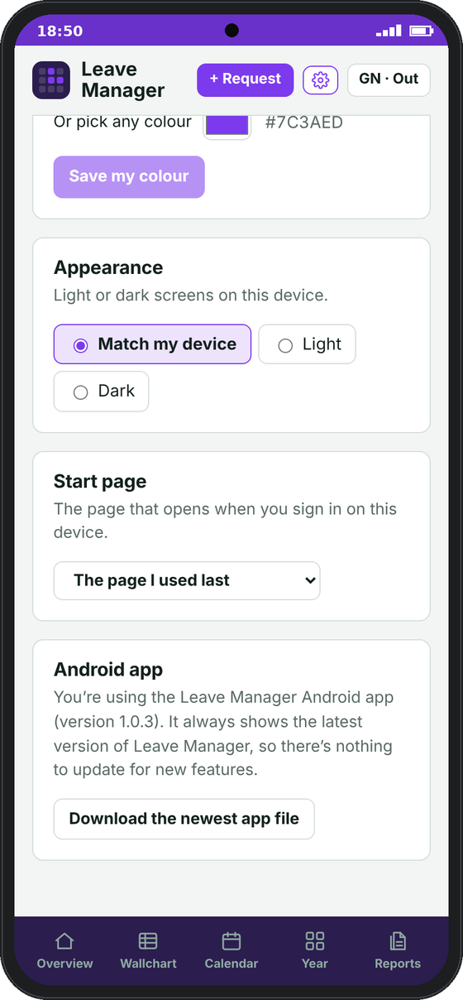

## Leave Manager on your phone

**Android:** open https://github.com/pian1966/leave-manager/releases/latest/download/LeaveManager.apk on your phone (or tap **Download the Android app** under **My settings**). Open the downloaded file and tap **Install**.
- If your phone asks, allow Chrome (or your browser) to install apps.
- If Play Protect says it doesn't recognise the app, tap **More details → Install anyway**. It's our own church app, so it isn't in the Play Store.

Then open **Leave Manager** from your apps and sign in with your email and PIN. To get the latest leave (for example after the Administrator approves something), tap **⟳** at the top, or pull the page down from the top. The app also refreshes by itself when you come back to it after a few minutes. When a newer version of the app is available, a banner at the top says **Update available**: tap **Update**, open the downloaded file and tap **Update**. You can also check yourself under **My settings → Android app → Check for updates**. The back button closes windows and takes you back to Overview. You can print reports from the app too.

**iPhone:** open Leave Manager in Safari, tap the **Share** button, then **Add to Home Screen**.

## Common questions

| Problem | What to do |
| --- | --- |
| “That email and PIN don't match” | Check the email spelling. If it still fails, ask the Administrator to check your details or reset your PIN. |
| “Your session has ended” | Sign in again. Sessions last about 6 hours. |
| “More than …’s allowance” | The request uses more days than you have left. You can still send it, but it always needs the Administrator’s approval and they'll see the warning. Check your balance on the Overview, or choose another leave type. |
| “Those dates are all days … doesn't work” | The dates fall on your days off or public holidays, so no leave is needed. |
| “Already booked the Weekend Off for this term” | You get one per school term. Choose a weekend in the next term. |
| A leave type is missing from the list | Your staff category doesn't get that type. |
| “Can't reach the leave server” | Check your internet connection and try again. If it keeps happening, tell the Administrator. |
| The page looks out of date | On a phone or in the Android app, tap **⟳** at the top or pull the page down. On a computer, press F5 (or Ctrl+Shift+R). |

Any other questions about your leave or allowance: speak to the Administrator.

*Administrators: see the [Administrator Guide](ADMIN-GUIDE.md).*

*Administrators: see the [Administrator Guide](ADMIN-GUIDE.md).*
